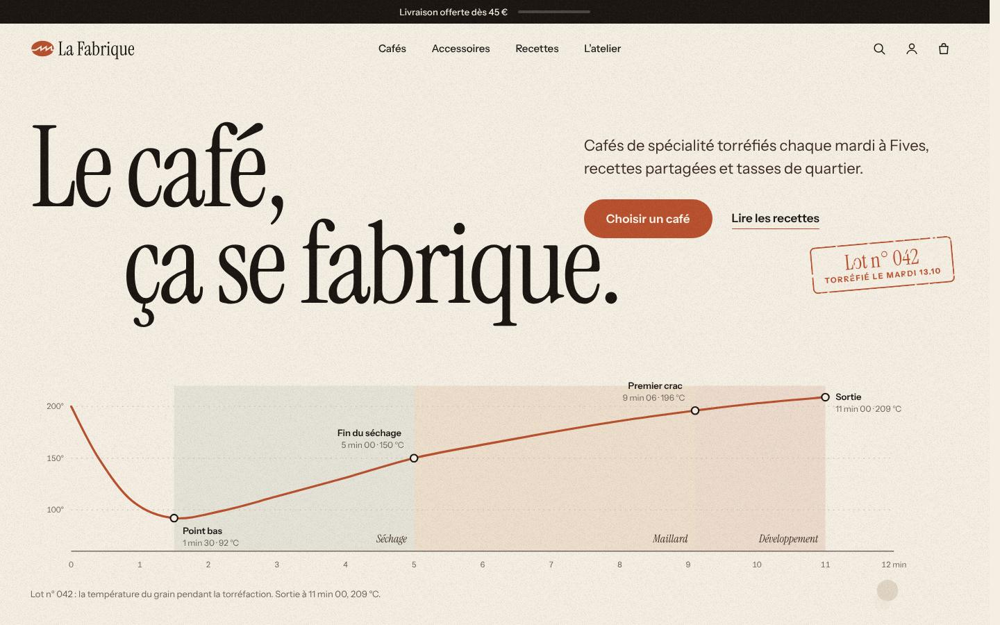
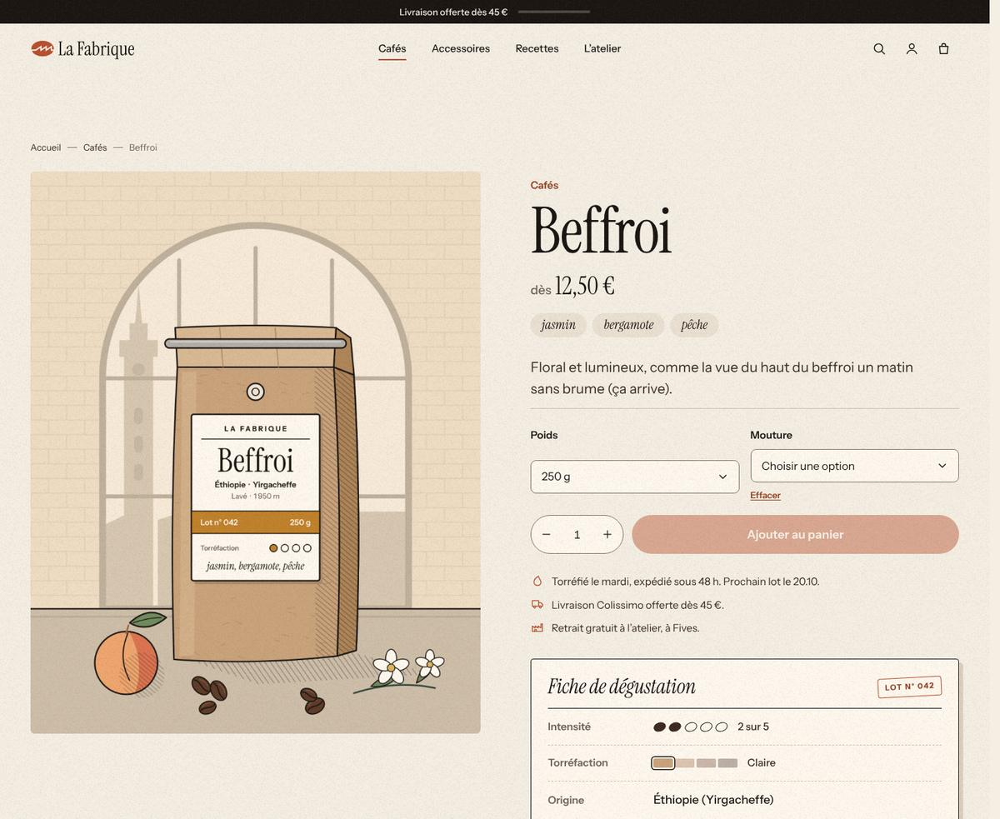
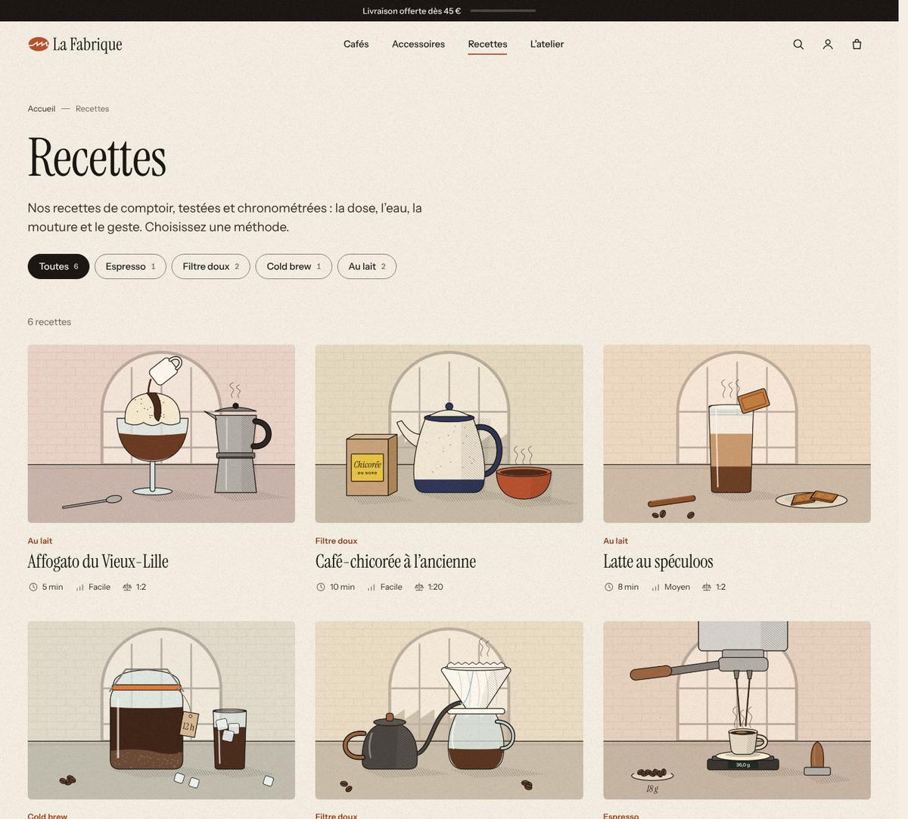
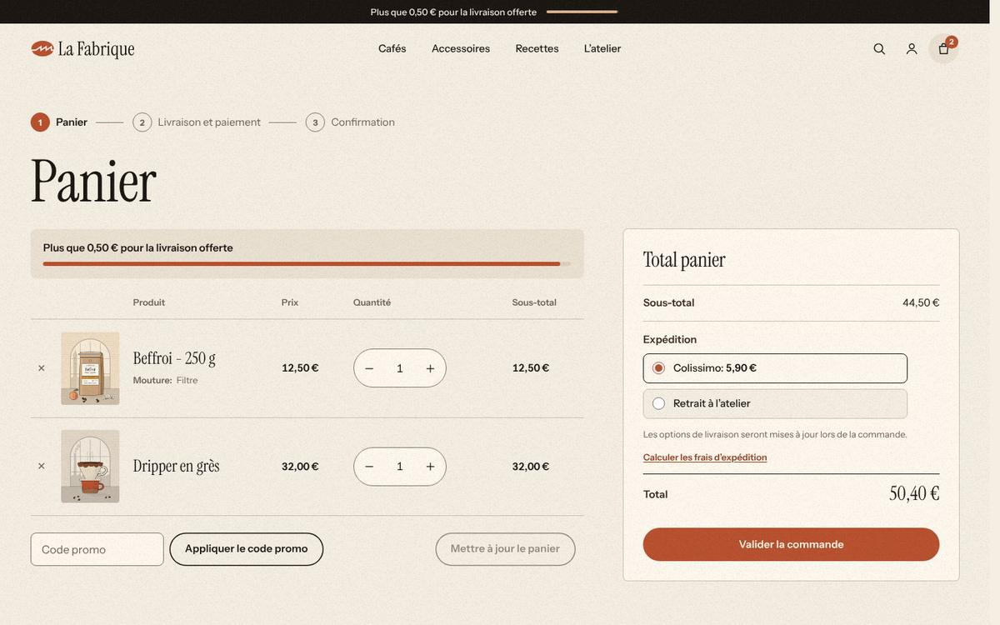
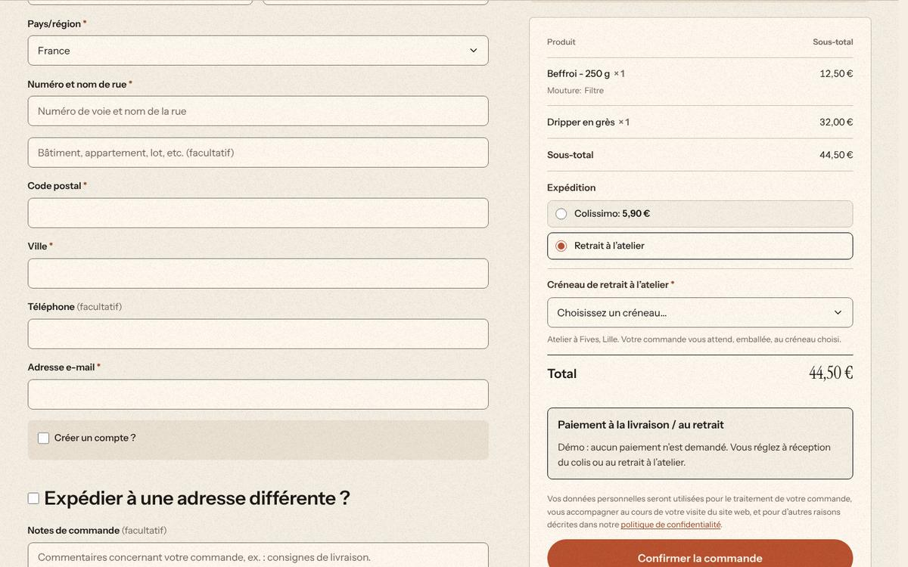
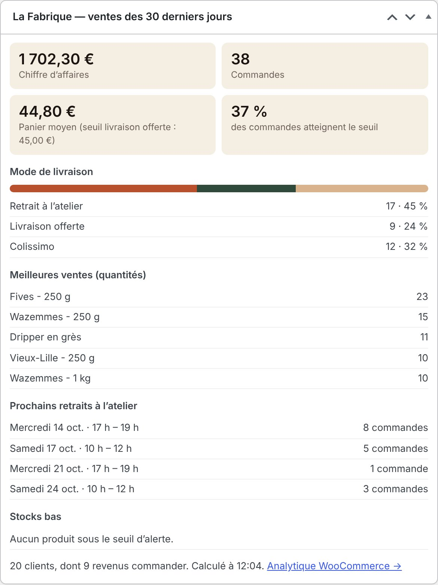
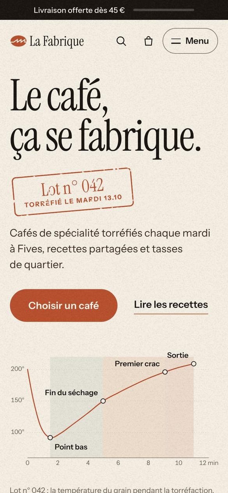
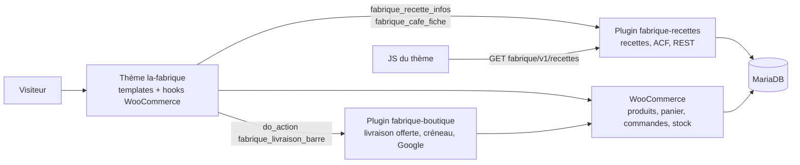

# La Fabrique — boutique WordPress / WooCommerce sur mesure

**La Fabrique** est un torréfacteur lillois *fictif* : cafés de spécialité torréfiés dans une ancienne filature de Fives, vendus en ligne avec retrait à l'atelier. Ce dépôt contient son site e-commerce complet : thème sur mesure, deux plugins maison, WooCommerce personnalisé par hooks, environnement Docker, contenus de démonstration et tests.



> Projet de démonstration (portfolio) : la marque, les produits et les illustrations sont inventés, aucune commande n'est réelle.

## Ce que montre ce projet

| Brique | Où regarder |
|---|---|
| **Environnement Docker** : MariaDB, WordPress 7.1 / PHP 8.3, WP-CLI, Mailpit ; installation en deux commandes | [`wordpress/docker-compose.yml`](wordpress/docker-compose.yml), [`wordpress/Makefile`](wordpress/Makefile), [`wordpress/bin/setup.sh`](wordpress/bin/setup.sh) |
| **Thème classique sur mesure** : hiérarchie des templates, `theme.json`, JS natif, animations, responsive, accessibilité | [`wordpress/wp-content/themes/la-fabrique/`](wordpress/wp-content/themes/la-fabrique) |
| **Type de contenu « Recettes » + ACF** : champs déclarés en PHP, taxonomie « méthode », fiche café sur les produits | [`wordpress/wp-content/plugins/fabrique-recettes/`](wordpress/wp-content/plugins/fabrique-recettes) |
| **WooCommerce personnalisé par hooks** (environ 60), sans surcharge de template | [`la-fabrique/inc/woocommerce.php`](wordpress/wp-content/themes/la-fabrique/inc/woocommerce.php) |
| **Plugin maison** : barre « livraison offerte », créneau de retrait obligatoire au checkout, connexion Google | [`wordpress/wp-content/plugins/fabrique-boutique/`](wordpress/wp-content/plugins/fabrique-boutique) |
| **Tableau de bord des ventes** dans l'admin : chiffre d'affaires, panier moyen face au seuil de livraison offerte, retrait ou expédition, meilleures ventes, prochains créneaux, stocks bas | [`class-tableau-de-bord.php`](wordpress/wp-content/plugins/fabrique-boutique/includes/class-tableau-de-bord.php) |
| **Route REST personnalisée** `GET /wp-json/fabrique/v1/recettes`, utilisée par le front | [`class-rest-recettes.php`](wordpress/wp-content/plugins/fabrique-recettes/includes/class-rest-recettes.php) |
| **Tests** : 80+ tests PHP, 2 parcours navigateur, WordPress Coding Standards | [`wordpress/tests/`](wordpress/tests) |

## Aperçu

| Fiche café | Recettes |
|---|---|
|  |  |

| Panier et barre « livraison offerte » | Commande avec retrait à l'atelier |
|---|---|
|  |  |

| Tableau de bord des ventes (admin) | Mobile |
|---|---|
|  |  |

## Démarrer

```sh
cd wordpress
make up       # crée .env, démarre la base, WordPress et Mailpit
make setup    # installe WordPress en français, WooCommerce, ACF, le thème, les plugins et la démo
```

Le site est sur http://localhost:8080 (admin : `admin` / `admin123`, **en local uniquement**), les e-mails sur http://localhost:8025.
Pour remplir le tableau de bord des ventes avec des commandes fictives : `make commandes`.
Sans Docker (Local, hébergeur avec WP-CLI, téléversement des zips) : voir [`docs/INSTALLATION.md`](docs/INSTALLATION.md).

## Architecture



**Les données dans les plugins, la présentation dans le thème.** Changer de thème ne fait perdre ni les recettes, ni les champs, ni les règles de la boutique. Le thème n'appelle que quelques fonctions publiques des plugins, toujours derrière `function_exists()` : il fonctionne même plugins désactivés.

### Le parcours d'une commande

1. **Ajout au panier en AJAX** : WooCommerce renvoie des *fragments* HTML ; la barre « livraison offerte » de l'en-tête et du mini-panier se met à jour sans rechargement.
2. **Commande** (tunnel classique `[woocommerce_checkout]`) : si « Retrait à l'atelier » est choisi, le plugin affiche le champ créneau et le **valide côté serveur** (`woocommerce_after_checkout_validation`) contre la liste des créneaux calculée par le serveur. Un créneau falsifié est refusé.
3. **Création de la commande** : le créneau est enregistré par l'API `WC_Order` (`woocommerce_checkout_create_order`), compatible avec le stockage HPOS. Il s'affiche ensuite dans l'admin, les e-mails, la page de remerciement et Mon compte.
4. **Stock** : au passage en « en cours » (paiement à la livraison), WooCommerce décrémente le stock de chaque produit ou variation (250 g et 1 kg ont chacun le leur), et le rend si la commande est annulée. Les commandes en attente de paiement réservent le stock 60 minutes. Les alertes de stock bas sont actives.

## Sécurité

- Sorties échappées (`esc_html`, `esc_attr`, `esc_url`, `wp_kses_post`), entrées nettoyées, nonces et contrôle des capacités sur chaque formulaire et chaque action d'administration.
- Route REST publique en lecture seule : arguments typés et validés, uniquement des recettes publiées.
- **Connexion Google** sans bibliothèque externe : jeton vérifié côté serveur (RS256 imposé, clés publiques de Google en cache, `aud`, `iss`, `exp`, `email_verified`), nonce à usage unique lié à un cookie, en-tête `Origin` vérifié, limitation de débit. **Pas de liaison automatique par e-mail** : WooCommerce permet de créer un compte sans vérifier l'adresse, donc un compte existant n'est jamais lié à Google sans que son propriétaire se connecte d'abord.
- Créneau de retrait validé contre la liste du serveur, jamais contre ce qu'envoie le navigateur.

## Qualité et tests

```sh
make test   # tests PHP dans Docker
make e2e    # parcours navigateur (Playwright)
make lint   # WordPress Coding Standards : 0 erreur
```

Détail des tests et des choix techniques : [`wordpress/README.md`](wordpress/README.md).

## Usage de l'IA

Ma démarche avec l'ia a été d'utiliser claude pour fabriquer la majeur partie de mon code en lui donnant des directives précises et un cahier des charges a suivre, Mon travail a été d'imaginer l expérience client, de tester le parcours d'achat de verifier les sotcks etc pour pouvoir faire des retours a l ia sur ce qui marche et ce qui ne marche pas, j y ai apporté également mes modifications faites a la main et j ai surtout demander a claude de m expliquer en detail mon code pour pouvoir avoir toujours la main dessus et comprendre ce que je produis , Un chef ne coupe plus forcément ses oignons, mais il doit savoir le faire : c’est pour ça que je me suis approprié le code avant de vous le présenter

Ce projet a été réalisé avec l'aide de **Claude** (Anthropic), utilisé comme une équipe :
- un cahier des charges écrit d'abord, avec des contrats figés entre le thème et les plugins ;
- un développeur « back » (plugins, Docker, contenus) et un développeur « thème », qui travaillaient en parallèle ;
- un **arbitre**, quand le code s'écartait du cahier des charges ;
- une **recette indépendante**, qui n'avait pas écrit le code.

**Ce qui a été vérifié, plutôt que cru sur parole :** les tests automatiques, le parcours d'achat dans un vrai navigateur, des attaques simulées sur la connexion Google (jetons forgés, rejeu, mauvaise origine) et sur le créneau (valeurs falsifiées), et le stock décrémenté après une vraie commande de test.

**Exemples d'erreurs repérées et corrigées pendant le projet :**
- un ratio de recette affiché « 1:17,0 » ;
- Colissimo payant présélectionné alors que la barre annonçait la livraison offerte ;
- des horaires de retrait recopiés en dur dans le thème, qui auraient divergé des réglages ;
- le risque de pré-détournement de compte avec une liaison Google automatique par e-mail.

**Limites assumées :**
- pas de vrai jeton Google dans les tests automatiques (clés de test injectées) ;
- tunnel de commande « blocs » de WooCommerce non couvert (le choix du tunnel classique est expliqué dans [`wordpress/README.md`](wordpress/README.md)) ;
- traductions officielles de WooCommerce installées par `setup.sh`, avec un accès Internet.

## Licence

Thème et plugins : GPL-2.0-or-later (comme WordPress). Polices Instrument Sans et Instrument Serif : SIL Open Font License.
